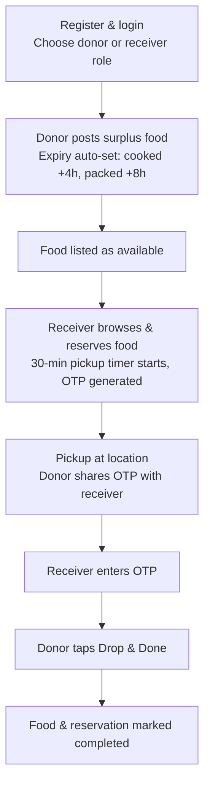
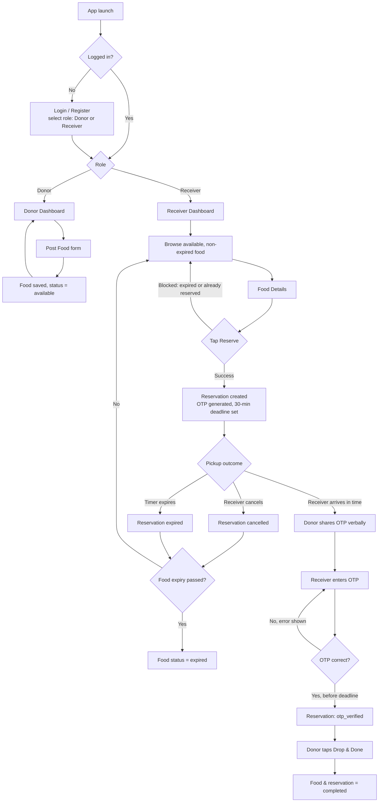
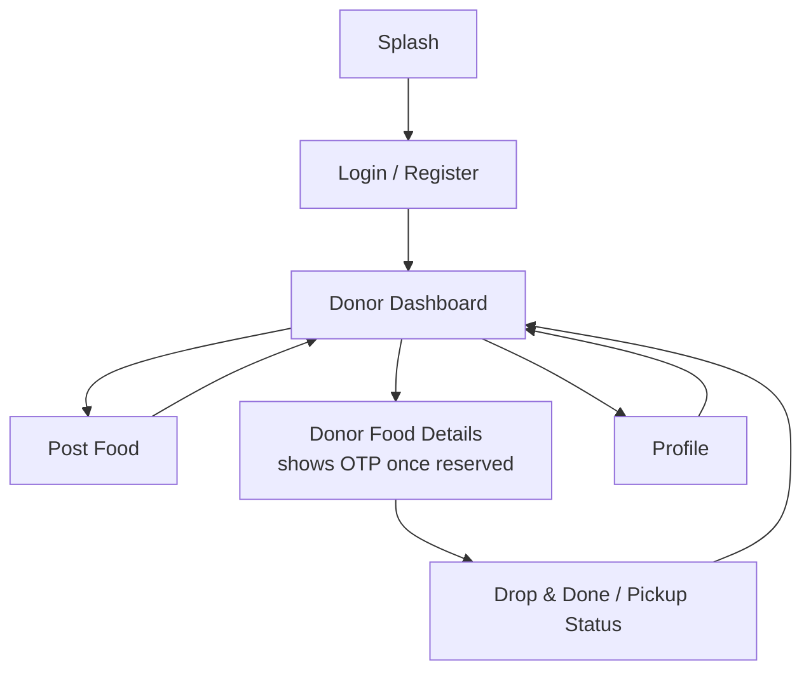
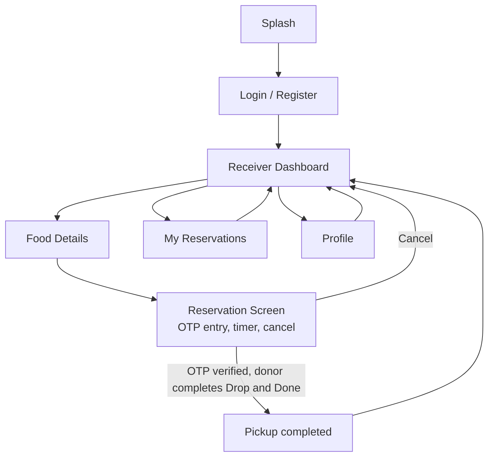

# User Flow & UI Screen Flow: Surplus Food Redistribution System Android MVP

## 1. Document Control

| Field | Details |
|---|---|
| Project | Surplus Food Redistribution System Android MVP |
| Document type | User Flow & UI Screen Flow |
| Related documents | PRD_Surplus_Food_Android_MVP.md (v1.0), SRD_Surplus_Food_Android_MVP.md (v1.0) |
| Platform | Android (Flutter + Firebase) |
| Version | 1.0 |

This document is a companion to the PRD and SRD. It maps the requirements in those documents to the actual navigation paths a Donor and a Receiver take through the app. Screen names, fields, and business rules are pulled directly from PRD section 11 (Screen and Module Requirements) and SRD section 6 (Functional System Requirements) — see those documents for full field-level detail.

## 2. Core User Flow

This is the single happy-path demo flow the MVP must support end to end (matches PRD section 3 and the acceptance flow in PRD 17.1).

## 3. Detailed Role-Based User Flow

This expands the core flow with the actual branch points and failure paths from PRD section 8 (User Journeys) and the edge cases in PRD section 15 / SRD section 16.

Key rule embedded in this flow: a cancelled or timed-out reservation only returns food to `available` if the food's own expiry hasn't passed (BR-10, BR-11) — otherwise it goes straight to `expired`.

## 4. UI Screen Inventory

| Screen | Category | Key elements | Primary actions |
|---|---|---|---|
| Splash/Startup | Common | Logo, loading state | Check login state, route accordingly |
| Login | Common | Email, password, register link | Authenticate, route by role |
| Register | Common | Name, email, phone, password, role, organization | Create account and profile |
| Profile | Common | Details, verification status, location, image | View/edit profile |
| Donor Dashboard | Donor | Status counts, donation list, status tags | Open donation, Post Food |
| Post Food | Donor | Name, type, quantity, description, prep time, image, location | Submit listing |
| Donor Food Details | Donor | Food info, reservation status, receiver info, OTP display | Monitor pickup |
| Drop & Done / Pickup Status | Donor | OTP status, pickup status, completion action | Complete handover |
| Receiver Dashboard | Receiver | Available food list, expiry countdown, distance | Open Food Details |
| Food Details | Receiver | Full details, donor info, map, Reserve button | Reserve food |
| Reservation Screen | Receiver | Food/donor info, location, OTP entry, timer, cancel | Enter OTP, cancel, open maps |
| My Reservations | Receiver | Active, cancelled, completed list | Resume active pickup |

## 5. Donor Screen Flow

## 6. Receiver Screen Flow

## 7. Screen Navigation Reference

| Screen | Entry from | Exits to |
|---|---|---|
| Splash | App launch | Login (unauthenticated) or Dashboard (authenticated) |
| Login / Register | Splash | Donor Dashboard or Receiver Dashboard, by role |
| Donor Dashboard | Login, Post Food, Drop & Done | Post Food, Donor Food Details, Profile |
| Post Food | Donor Dashboard | Donor Dashboard (on submit) |
| Donor Food Details | Donor Dashboard | Drop & Done / Pickup Status |
| Drop & Done | Donor Food Details | Donor Dashboard (on completion) |
| Receiver Dashboard | Login, Reservation Screen, My Reservations | Food Details, My Reservations, Profile |
| Food Details | Receiver Dashboard | Reservation Screen (on Reserve) |
| Reservation Screen | Food Details | Receiver Dashboard (cancel or complete) |
| My Reservations | Receiver Dashboard | Receiver Dashboard, or back into an active Reservation Screen |
| Profile | Either Dashboard | Same Dashboard |

## 8. Edge Cases Mapped To Screens

| ID (PRD / SRD) | Scenario | Screen(s) affected |
|---|---|---|
| EC-01 / SR-EC-001 | Two receivers reserve simultaneously | Food Details, Receiver Dashboard |
| EC-02 / SR-EC-002 | Reserve attempt on already-expired food | Food Details |
| EC-03 / SR-EC-004 | Cancel after food expiry | Reservation Screen |
| EC-04 / SR-EC-003 | Timer reaches zero while app closed | Reservation Screen, Donor Food Details (recalculated on load) |
| EC-05 / SR-EC-005 | Wrong OTP entered | Reservation Screen |
| EC-06 / SR-EC-006 | Correct OTP entered after deadline | Reservation Screen |
| EC-08 / SR-EC-011 | Location permission denied | Post Food, Food Details |
| EC-09 / SR-EC-010 | Image upload fails | Post Food |
| EC-10 | Network drops during reserve | Food Details |
| EC-11 / SR-FR-027 | Donor tries to reserve own food | Food Details (action blocked) |
| EC-12 / SR-EC-012 | Completed reservation reopened | Donor Food Details, Reservation Screen, My Reservations (read-only) |

## 9. State Transitions Quick Reference

Full detail is in PRD section 14. Condensed for screen-design purposes:

**Food status:** `available` → `reserved` → `completed`, with `available`/`reserved` → `expired` at any point expiry passes, and `reserved` → `available` on a valid cancel/timeout.

**Reservation status:** `active` → `otp_verified` → `completed`, or `active` → `cancelled` / `expired`.

Any screen that displays status (Donor Food Details, Food Details, Reservation Screen, My Reservations) should read these from Firestore on load rather than trusting cached local state, per SR-FR-036 and NFR-03.
